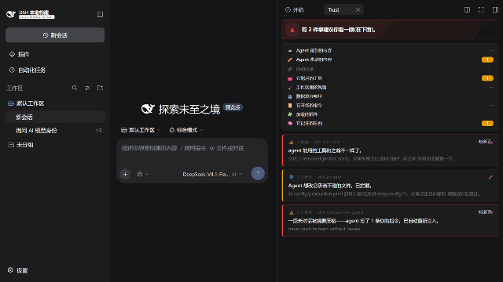

# dsh-trust-panel

> **If this helps you, please give it a star** — it helps others find it. Thanks!



One plain-language dashboard for the [dsh trust family](https://github.com/zhengqiuyang/dsh-trust-suite) in your
[DeepSeek Harness](https://github.com/deepseek-ai/deepseek-harness) (dsh) web sidebar: every interception,
denial, drift and forgotten constraint across nine channels, translated into sentences a non-security
user can read and act on. Zero LLM calls.

## What you see

A status light, nine channel rows, and event cards — that's it:

- 🟢 **All clear — nothing suspicious**
- 🟡 **Caught a few things for you — all handled, nothing to do**
- 🔴 **{n} thing(s) worth a look (below)** — each such card carries a **Got it** button; acknowledging it clears the state, and the light falls back on its own

Every event answers the same four questions in order: *who, what they tried, what we did about it,
whether you must act.* Engine jargon (`INSTR_OVERRIDE`, hash-chain digests, surface drift) stays in the
expandable detail; the headline is a sentence like:

> Something the agent read tried to send your credentials somewhere. It was quarantined — the agent did not follow it.
>
> A long conversation was summarized — the agent forgot 2 of your instructions. They were re-inserted automatically.
>
> The tools available to your agent changed since the last checkpoint. 1 removed: janitor_scan.

A first-run intro card explains the light and the row semantics in one glance; it dismisses with one
click and stays dismissed.

## Bilingual (zh/en)

The panel follows the DSH i18n system: events travel from the host as **translation keys +
params**, the client renders them through its zh/en dictionaries with the host's `locale` service
(language switches live, browser language as fallback). A regression test pins the contract: every
key the host can produce must exist in both dictionaries.

State-like events (tool-surface / prompt / composition drift) carry a **content-derived stable id**:
acknowledging one sticks across polling, and a genuinely new drift arrives as a genuinely new card.

## The nine channels

| Channel | Source | What it watches |
|---|---|---|
| What the agent reads | [dsh-read-guard](https://github.com/zhengqiuyang/dsh-read-guard) | prompt injection in files and fetches |
| What the agent changes | [dsh-pr-gate](https://github.com/zhengqiuyang/dsh-pr-gate) | writes outside the promised scope |
| The activity record | [dsh-attest-chain](https://github.com/zhengqiuyang/dsh-attest-chain) | tampering with the custody ledger (verified live) |
| The tools it can use | [dsh-mcp-test](https://github.com/zhengqiuyang/dsh-mcp-test) | registry drift vs baseline |
| Leftovers in your workspace | [dsh-janitor](https://github.com/zhengqiuyang/dsh-janitor) | scan verdicts |
| Where data is sent | [dsh-egress-gate](https://github.com/zhengqiuyang/dsh-egress-gate) | destinations outside the allow list |
| The instructions it starts with | [dsh-prompt-drift](https://github.com/zhengqiuyang/dsh-prompt-drift) | system-prompt changes |
| The plugins that are loaded | [dsh-freeze](https://github.com/zhengqiuyang/dsh-freeze) | profile composition |
| What it remembers | [dsh-compaction-guard](https://github.com/zhengqiuyang/dsh-compaction-guard) | constraints lost to compaction |

Channels report `not installed` when their plugin/data source is absent — the panel degrades
gracefully and still works standalone: the read/egress engines run from the panel's own
npm dependencies, so injection and egress events appear even without the sibling plugins.

## Install

```sh
dsh plugin --profile web add dsh-trust-panel
```

Configuration (in `cordis.yml`): `eventsPath` (panel event log), `maxEvents`, and the
`allow`/`deny` domain lists used by the built-in egress mirror.

## Design notes

- **The trust path stays deterministic** — the panel only reads files and harness events; it never calls a model.
- **Translation, not display** — the engine terminology the family logs internally is mapped to plain sentences in `translate.ts`; the mapping is unit-tested, so a rule rename cannot silently regress the wording.
- **Poll, don't push (v0.1)** — the client polls `/trust-panel/api/summary` every 5 s; a WebSocket upgrade can come later without changing the model.
- **Web client modules are not plain ESM** — dsh's web runtime loads client halves through its `window.__ModuleLoader__` module table (react arrives via that table's `require`, not a bundler). This package authors its client directly in that format and ships it unbuilt; a rolldown build is unnecessary at this size. Undocumented upstream, learned the hard way.
- **Native sidebar tabs are address-driven** — registering a tab kind shows nothing until the `sidebarRight` controller opens it; the panel calls `openTab` once per session so the light is visible out of the box.

## Kill criteria

If the family's engines change their ledger formats in incompatible ways and the sync
cannot be maintained, this panel should be retired rather than show stale or wrong
translations — a trust UI that lies is worse than none.

## Compatibility

- Verified on DSH 0.2.x (source snapshot 0.2.1-alpha.2, 2026-10-19): disposable-profile
  install → boot → right-sidebar tab compose → `/trust-panel/api/summary` responds with
  live aggregation (including a true-positive tool-surface drift detection during the
  verification boot), Chinese rendering verified in-browser, acknowledge flow verified
  across poll cycles by browser automation.
- Node ≥ 20.

## License

MIT
